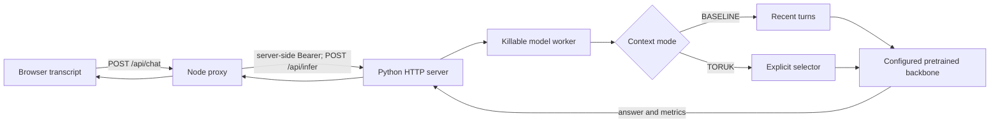

# Chatbot launch readiness gate — 7 November 2026

**Local offer: a working, explicitly experimental external-model chat demo on
loopback. Public deployment: BLOCKED.** Every tested configuration failed the
frozen quality gate. Local HTTP reliability passing does not establish answer
quality. No hosting was purchased, service deployed, chat model trained or tuned,
commit created, or changes pushed.
Verification smokes train only their small, separately recorded fixtures.

Starting commit: `a450a0d6c4f293fb9b500968c35a5c051787d0a6`, branch `main`, clean
working tree. Earlier prompts were not accepted as proof: current runtime code,
checkpoints, latest owned-model results, request handling, hosting recipes and CI
were inspected, then actual inference was run. The final working tree is dirty
with the changes below; [status](../../artifacts/chat-launch-gate-20261107/git-status.txt)
records it. Prior research weights and frozen evaluations were not overwritten.

## Actual request path and identities



The browser retains the transcript in memory. The server is stateless across
requests; New chat clears the browser history. Follow-up requests include actual
generated assistant turns. Toruk is the application/backend identifier, **not**
the provenance of pretrained answers. The UI now labels replies Assistant and
shows the model's origin, backbone, revision-bearing identity and selector.
The optional ordinary `--checkpoint` branch instead calls the ordinary byte
generator directly in BASELINE; it does not load an external backbone. For
Ollama, the worker is a client to the separate local daemon at port 11434.

| Configuration | Actual generator | Context selection |
| --- | --- | --- |
| Qwen BASELINE | `Qwen/Qwen2.5-0.5B-Instruct@7ae557604adf` | Recent turns |
| Qwen TORUK, trained v2 | Same Qwen weights | Separate trained eight-feature turn ranker |
| Qwen TORUK, lexical-v2 | Same Qwen weights | Deterministic heuristic, not learned memory |
| Legacy SmolLM BASELINE | `HuggingFaceTB/SmolLM2-135M-Instruct@12fd25f77366` | Recent turns |
| Ollama BASELINE / TORUK | `ollama/llama3.2:latest@a80c4f17acd5`, installed 3.2B Q4_K_M | Recent / same trained v2 ranker |
| Ordinary Toruk smoke fixture | `toruk-ordinary-v1:0285d3fb6adc` | Ordinary byte LM, not chat-trained |
| Latest owned conversation candidate | `toruk-owned-next-token-v1@af3eecde2613` | Owned recurrent state; **research CLI only**, not accepted by the chat server's ordinary loader |

Full Qwen revision: `7ae557604adf67be50417f59c2c2f167def9a775`; weight SHA-256:
`fdf756fa7fcbe7404d5c60e26bff1a0c8b8aa1f72ced49e7dd0210fe288fb7fe`.
SmolLM weight SHA-256:
`5af571cbf074e6d21a03528d2330792e532ca608f24ac70a143f6b369968ab8c`.
Ollama digest:
`a80c4f17acd55265feec403c7aef86be0c25983ab279d83f3bcd3abbcb5b8b72`.
The trained selector SHA-256 is
`abd9d2d1c20edb3ad5cf3282f8a26fca49fb44d508d4ba2ada5ebc9c666b7548`.
Identity was checked through the real proxy and against model-loading metadata;
Ollama also verifies its installed digest around requests. No fallback occurs.
Historical M6 weights remain absent. Other selectors/backbone combinations are
not qualified by these measurements.

## Gates frozen before evaluation

[Configuration](../../configs/chat-launch-gate-v1.json),
[registration](../../artifacts/chat-launch-gate-20261107/registration.json) and
[suite](../../artifacts/chat-launch-gate-20261107/suite.json) bind the existing
25 published regression histories, a natural greeting, eight generated-history
scenarios, and three repeated math turns following the full recorded refusal
transcript. Each network configuration makes 41 main chat requests, scoring 37
cases/final turns. Intermediate assistant replies are model-generated and retained.
This is development/regression qualification, not new held-out research evidence.
Driver exit code 0 means evaluation completed; the JSON quality verdict can
still be FAIL. It must not be treated as a release pass.

The minimum is 80% overall quality, 60% in every category, zero exact-string,
unsupported-abstention-proxy or refusal/math failures, zero repeated word
trigrams, and 100% successful expected chat responses. Reliability separately
requires identity parity, actionable redacted errors, bounded requests, correct
outage/admission behavior, startup within 120 seconds and requests within 45.
External models use 64 native tokens, greedy temperature 0/top-p 1. The owned
interface permits only 32 generated byte tokens; its unequal tokenizer, training,
scale and prompt bounds prevent a matched model-quality/resource comparison.

An initial driver preflight was stopped after static analysis caught a driver
variable collision; its source/logs remain in `artifacts/chat-launch-20261107`.
The final cases and gates are identical; no model, answers or thresholds were
tuned. Ollama's later availability discovery uses the same frozen suite/scorer,
with separate before-run driver/digest registrations. A formatting-only string
split has an archived as-run driver and verified executable-AST parity.

## Quality, failures and scorer limitations

| Configuration | Frozen quality /37 | Common static cases /25 | Post-hoc semantic review /37 | Gate |
| --- | ---: | ---: | ---: | --- |
| Qwen recent | 25 | 14 | 30 | FAIL |
| Qwen trained v2 | 25 | 15 | 32 | FAIL |
| Qwen lexical-v2 | 27 | 16 | 32 | FAIL |
| SmolLM recent | 18 | 13 | Not adjudicated | FAIL |
| Ordinary Toruk fixture | 0 | 0 | Not adjudicated | FAIL |
| Ollama recent | 28 | 16 | 31 | FAIL |
| Ollama trained v2 | 28 | 16 | 31 | FAIL |

The separately run latest owned conversational checkpoint scores **0/25**; the
full refusal prefix exceeds its interface bound. The earlier 0/24 primary answer
result was not treated as a new test: fresh CLI generation here confirms the
negative result on the published regression set. It remains experimental.

The frozen scorer has identifiable false negatives: its uncertainty phrase list
omits the correct literal `Unknown`, and its numeric rule misses English `ten`.
The generated conflict rubric also misses a valid impossibility paraphrase.
Frozen scores/results were **not edited**. [Separate semantic review](../../artifacts/chat-launch-gate-20261107/semantic-review-all.json)
accepts those identified replies. The four Qwen abstention-proxy flags are not four
fabricated facts; the three Ollama flags likewise include valid `Unknown` replies.
Malformed owned outputs and SmolLM proxy failures are not reliable factual
hallucination counts. This scoring limitation is reported rather than concealed.

Even with those review adjustments, Qwen fails the per-category gate: literal
instruction following is 0/3; recent/trained correction is 1/3, and recent
distant literal recall is 1/3. Ollama correction/recall/exact strings are 3/3,
but literal instructions and benign factual-label questions are each 0/3.
Its repeated-trigram count is 4/5 across the two modes, a repetition proxy rather
than proof of pathological loops. No reviewed score establishes public readiness.

Selected actual replies:

| Configuration / case | Expected | Generated |
| --- | --- | --- |
| Qwen recent / `test-correction-0` | New `Evaluecorrection0` | `Eoldcorrection0` |
| Qwen recent / `test-instruction-0` | `Evalueinstruction0` only | `Evaluating instruction 0` |
| Qwen recent / uncertainty | `Unknown` | `Unknown` (scorer false negative) |
| Qwen recent / refusal math | `10` | `The sum of five plus five is ten.` (valid math) |
| SmolLM / full recorded refusal | `10` | Earlier online-content refusal repeated |
| Owned candidate / instruction | Held-out value | `"Tvalueinstruction6"` plus newline: wrong training value |

SmolLM repeats the online-content refusal on all three subsequent math turns.
Qwen and Ollama answer those math continuations correctly under semantic review;
do not relabel their number-word responses as a reproduced refusal failure.
Ollama instead refuses benign label questions with claims about harmful/illegal
activity or gender labels, unrelated to the supplied synthetic facts.
Full [raw replies](../../artifacts/chat-launch-gate-20261107/raw-answers.md),
histories, selected message IDs, errors and scores are retained in per-mode JSON.

## Costs and hosting measurements

These are local Windows measurements, not Linux/cloud benchmarks. Torch is
2.14.1+cpu; Qwen/SmolLM use two Torch CPU threads. The host has 12 logical CPUs
and about 25.1 GB physical RAM. No new weights were downloaded.

Main-request totals below include all 41 requests, including generated-history
setup turns. Static 25-case histories are matched; generated rollout histories
can diverge because each mode retains its own actual replies. Native tokens
across different model tokenizers are not interchangeable.

| Configuration | Full input tokens | Selected prompt tokens | Output tokens | Selector ms | Proxy wall sum s |
| --- | ---: | ---: | ---: | ---: | ---: |
| Qwen recent | 5,614 | 5,614 | 379 | 0 | 96.84 |
| Qwen trained v2 | 5,600 | 4,894 | 359 | 1.150 | 91.43 |
| Qwen lexical-v2 | 5,617 | 4,978 | 382 | 1.691 | 92.17 |
| SmolLM recent | 3,541 | 3,541 | 1,149 | 0 | 66.36 |
| Ollama recent | 3,062 | 3,062 | 701 | 0 | 92.20 |
| Ollama trained v2 | 3,060 | 2,311 | 694 | 1.513 | 97.47 |

Qwen main-request inference-tree CPU totals are 192.31/181.47/181.20 seconds for
recent/trained/heuristic modes. The trained and heuristic selectors additionally
scan 5,694/5,718 content bytes across the rollouts. Full-history tokenization,
prompt fitting and selector overhead are recorded separately; backend/proxy wall
time includes them. There is no persistent Toruk session state in these external
paths. Ollama allocates its own model/KV state and meters history with additional
model calls: total reported prompt-evaluation tokens are **9,186/7,682**, beyond
the selected prompts. Tiny metering outputs are not included in the primary
output-token total. This is not a complete FLOP/energy/bill measurement.

No total-resource efficiency advantage is established: quality gates fail,
rollouts and host/cache conditions differ, and not all process/GPU costs are
isolated. In particular the Ollama selector uses fewer selected tokens but takes
more measured request time. CPU sums omit browser/proxy CPU and are not GPU work.

| Qwen CPU deployment input | Measurement |
| --- | --- |
| Weight file | 988,097,824 bytes |
| Full local backbone directory | 999,605,252 bytes |
| Installed Windows dependency closure, 35 distributions | 844,038,170 logical file bytes; excludes Python/OS libraries, app and weights |
| Inference source allowlist | 122,486 bytes; 39,863-byte source-only ZIP |
| Final static/Node frontend runtime files | 23,511 bytes; no Torch or weights |
| Separate process-profile readiness | 13.525 s |
| Readiness plus first response | 16.076 s |
| First / next greeting | 2.552 / 2.310 s |
| Profile peak summed RSS / private committed bytes | 2,629,824,512 / 4,614,537,216 |
| Largest observed Qwen peaks across qualification | About 2.68 GB summed RSS / 4.66 GB private committed |
| Main-request p95, recent/trained/heuristic | 4.42 / 2.94 / 3.28 s |
| Main-request maximum, recent/trained/heuristic | 9.01 / 9.99 / 9.29 s |
| Four simultaneous requests | One 200; three immediate safe busy 503 responses |

Summed RSS can double-count shared pages; private committed bytes are not resident
RAM. These are sampled peaks, not OS memory limits. Estimate 6 GB available RAM,
preferably 8 GB headroom, pending Linux measurement. The profile also records
29.81 inference-tree lifecycle CPU seconds over 24.61 wall seconds, including
startup, two greetings and the concurrent admission probe. These small profiles
are not sustained throughput or multi-user service guarantees.

Ollama's installed-model API reports 2,019,393,189 bytes, 3.2B Q4_K_M and a
2,567,826,307-byte loaded-model snapshot, with **0 VRAM allocated** in this run.
Do not reuse the older GPU qualification's memory numbers. The name-based sampler
missed `llama-server.exe`; its small Ollama-named-process RSS is **not** total
inference memory. A [post-run process snapshot](../../artifacts/chat-launch-gate-20261107/ollama-process-snapshot.json)
finds that runner at 2,937,217,024 RSS bytes, 2,944,102,400 lifetime peak RSS,
and 3,033,255,936 private bytes, plus client/daemon processes. Those snapshots
do not establish an isolated aggregate peak. Ollama remains a separate service
and may retain its model for its normal five-minute keep-alive after requests.

## Public host decision and cost-aware conditional plan

Official documentation checked 7 November 2026:

* **Vercel:** keep `web/vercel` as the project root: static UI plus Node proxy.
  Standard functions document 250 MB uncompressed bundles, 500 MB for Python,
  and Hobby memory of 2 GB. Current documented Hobby duration is 300 seconds;
  this project's function configuration is 70 seconds around a 60-second proxy
  deadline. The measured stock Torch/Qwen package and memory do not fit that
  standard Hobby inference path; the long-lived Python HTTP server is also not
  a serverless handler. Larger paid/beta configurations were not qualified.
  [Official function limits](https://vercel.com/docs/functions/limitations).
* Hobby is personal/non-commercial, with monthly allowances including 4 CPU hours,
  360 GB-hours memory and one million invocations. These frontend allowances do
  not provide the separate model computer or unlimited inference.
  [Official Hobby terms](https://vercel.com/docs/plans/hobby).
* **Separate inference:** a conditional Hugging Face Docker CPU Basic candidate
  documents 2 vCPU, 16 GB RAM, 50 GB ephemeral disk and no hourly CPU charge.
  Creating compute Spaces requires a paid plan; current SDK guidance requires
  PRO for a personal CPU Basic Docker Space. Protected visibility keeps source
  private while exposing the app, unlike a fully private Space, whose platform
  authorization is not supplied by this proxy's app token.
  [Spaces overview](https://huggingface.co/docs/hub/spaces-overview),
  [current SDK requirements](https://huggingface.co/docs/huggingface_hub/guides/manage-spaces).
* PRO is currently advertised at **$9/month**, not zero. CPU Basic sleeps after
  48 hours inactive, with unmeasured restart latency. Paid CPU Upgrade is listed
  at $0.03/hour (about $21.60 per 30 days continuously running), before any
  applicable subscription/other charges. No account eligibility, budget or SLA
  was confirmed or purchased.
  [Pricing](https://huggingface.co/pricing),
  [sleep behavior](https://huggingface.co/docs/hub/spaces-gpus),
  [hardware prices](https://huggingface.co/docs/hub/spaces-overview).

That is a conditional resource/cost plan, **not authorization or a deployment**.
Before public use the blockers remain: failed model quality; a real browser
interaction check; Linux container/peak-memory/cold-start/concurrency qualification;
hosting account/budget/visibility setup; end-user admission/rate/budget controls;
and an actual authenticated HTTPS proxy/host test. The shared backend token and
single-generation semaphore do not implement per-user access or fair queuing.

Docker CLI is installed but its daemon was unavailable; no Linux image was built.
The legacy recipe still selects SmolLM plus the missing original M6 checkpoint,
so it is not a deployable Qwen baseline recipe. Its source allowlist also missed
`chat_selector` and `ollama_chat`; those imports are repaired and closure-tested,
but that is not a successful container test. Qwen attribution/license metadata
must accompany any weight distribution; do not assume all model licenses match.
Toruk source/checkpoint publication terms must be chosen if distributing them.

## Reliability fixes, checks and exact local use

Backend status `/api/status` and alias `/status` return explicit readiness;
`/healthz` is 200 ready or 503 unready. Missing checkpoints/backbones, invalid
weights/dependencies, and stopped workers fail visibly without substitution.
The worker has a killable 45-second generation deadline; Node aborts at 60
seconds. Killing an Ollama client worker does not itself prove that separate
upstream model computation has stopped; upstream cancellation remains unverified.

Bounds are 20 messages, 1,024 UTF-8 bytes/message, 8,192 history bytes, 16,384
request bytes, 512 selected template-inclusive prompt tokens and 64 output tokens.
Old turns can be dropped whole during prompt fitting. Oversized latest turns are
rejected. The server has eight connection threads and one generation slot; the
four-way burst test is not a guarantee about all overload levels.

The reproduced proxy defect converted backend deadline HTTP 504 into 503. It now
preserves 504 with restart guidance. Busy responses have safe `INFERENCE_BUSY`
503 semantics and retry guidance. Public errors never relay upstream exception
strings, private paths or tokens. Status now forwards full backbone revision/hash.
The UI distinguishes external backbones from Toruk smoke fixtures, labels replies
Assistant, and defaults to the tested 64-token budget. No canned answer was added.

`scripts/verify.py --prefix launch --output-dir .readiness/chat-launch-verification-20261107`
completed with **no failed checks**, including 234 Python tests, both-platform
mypy (34 files), frozen-source checks, lint/format, CLI/config/ordinary/recurrent/
owned smoke checks, package dependencies and build. Final standalone Node syntax
checks pass; Node tests have **20 passes and one optional live-case skip**.
The real-network page-handler test passed separately against Qwen and against the
Python fixture. It executes actual page handlers in a DOM stand-in, not a visual
browser. The Browser skill found no connected browser; interactive/visual checking
is **NOT_RUN**. Missing-model startup smoke also passed for both source types.
Additional helpers/final wording passed focused checks after the full verify run.
Exact commands, exit codes and logs are in the retained verification evidence.

The starting commit's [GitHub Actions run 42067702086](https://github.com/ShamGaneshan2008/Toruk/actions/runs/42067702086)
passed both jobs, including chat dependencies, Python/Node integration, frozen
source checks, lint, types, tests, owned/recurrent smokes and build. It does not
run downloaded-backbone inference or a hosted deployment. Current uncommitted
changes are **NOT_RUN remotely**. Local results are not represented as remote CI.

Windows PowerShell, from the repository root, with existing verified Qwen files
and `.venv` dependencies (installation details in [local-chat.md](../local-chat.md)):

```powershell
# Terminal 1
Set-Location 'C:\Users\susee\VS_CODE_PROJECT\Toruk'
$env:TORUK_BACKEND_TOKEN = 'local-development-only-token'
.\.venv\Scripts\python.exe -m toruk_lm.inference_server --backbone-dir .\artifacts\qwen-chat-001\backbone --host 127.0.0.1 --port 8766

# Terminal 2, after Terminal 1 reports Chat ready
Set-Location 'C:\Users\susee\VS_CODE_PROJECT\Toruk'
$env:TORUK_BACKEND_TOKEN = 'local-development-only-token'
$env:TORUK_BACKEND_URL = 'http://127.0.0.1:8766'
$env:VERCEL_ENV = 'development'
$env:PORT = '3000'
node .\web\vercel\scripts\dev.mjs
```

From another PowerShell terminal:

```powershell
Invoke-RestMethod 'http://127.0.0.1:8766/healthz'
Invoke-RestMethod 'http://127.0.0.1:3000/api/status'
Start-Process 'http://127.0.0.1:3000'
$body = @{messages=@(@{role='user';content='What is 2 + 3?'});mode='BASELINE';max_new_tokens=64;temperature=0;top_p=1} | ConvertTo-Json -Depth 6
(Invoke-RestMethod 'http://127.0.0.1:3000/api/chat' -Method Post -ContentType 'application/json' -Body $body).answer
```

Press Ctrl+C in both server terminals to stop. Wait for readiness before sending;
use Retry connection after restart. If ports are occupied, choose two free ports
and update the URL/PORT consistently; do not stop unrelated processes. The gate
tested these startup settings with free loopback ports, actual HTTP and cleanup.
The literal token above is only for loopback development, never a public secret.
Alternative digest-pinned Ollama startup is documented in chat-foundation.md;
it is also experimental and did not pass this gate.

Files changed: README; architecture/local/deployment docs; inference busy response
and timing telemetry; Node proxy error/identity forwarding; UI origin/wording/
default budget; focused Python/Node tests; inference-package import allowlist;
host measurement; new frozen gate config and two local qualification drivers.
Artifacts preserve registration, model identities, raw replies, semantic review,
all measurements, source snapshots and verification. No training fixtures or
historical evaluation results were edited.

**ONE recommended next action:** run a development-only literal-value/correction
fidelity diagnostic, keeping this published launch suite and its gates frozen.
