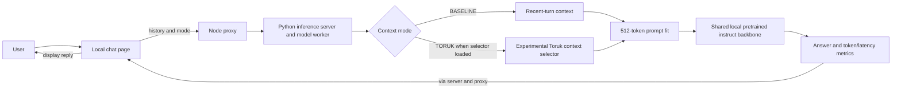

<div align="center">
  <h1>TORUK</h1>
  <p><strong>Remember what matters. Revise what changed.</strong></p>
  <p>A language-model research foundation with experimental bounded-memory prototypes.</p>
  <p></p>
</div>

[Research focus](#research-focus) · [Development status](#development-status) · [Getting started](#getting-started) · [Roadmap](#roadmap)

## Overview

Toruk investigates how a language model can carry useful information through a long stream while operating with bounded internal memory. The model family is **Toruk-LM**; its Python package is **`toruk_lm`**. The central question is whether a model can retain relevant context, incorporate corrections, and preserve facts that remain valid without letting its memory grow with every new piece of text.

The repository includes a compact causal language model and research prototypes for bounded memory, effect prediction, and correction/preservation training. Bounded validation and exploratory held-out studies have run; useful recall, reliable revision, generalization, and resource advantages remain unestablished.

## Implemented conversational chat flow



The ordinary small Toruk LM and controlled recurrent research pipeline are separate from this conversational path; the ordinary demo checkpoint is not its chat backbone. The pretrained backbone supplies the chatbot's language ability. Toruk's accuracy and efficiency advantage has not been verified; the optional selector can omit needed context.

## Why this matters

Long histories contain both useful facts and distractions. Some facts later change; others must survive those changes. A fixed memory budget makes every update a choice: what should remain available, what should be revised, and what must not be disturbed?

Toruk aims to study those choices through controlled comparisons with simpler language models, alongside measurements of the resources each approach uses.

## Research focus

| Area | Research question | Intended assessment |
| --- | --- | --- |
| Retention | Can earlier information remain useful after it leaves the local text window? | Delayed-recall tasks at increasing distances from the evidence. |
| Revision | Can later corrections replace outdated information? | Accuracy on corrected facts. |
| Preservation | Can a correction leave unrelated valid facts intact? | Accuracy on unchanged facts after a correction. |
| Resource efficiency | What does improved recall cost under a fixed memory budget? | State size, throughput, and total history-to-answer latency. |

**Illustrative research objective.** A record says *Mira lives in Pune and works as a botanist*. Later, it says *Mira moved to Jaipur*. A successful response would use **Jaipur** for her city while retaining **botanist** as her occupation. This is an example of the behavior Toruk aims to study, not a model result.

## What Toruk investigates

The project aims to explore memory within the model's computation, with explicit capacity limits. Planned experiments will test recall alongside correction and preservation, then compare any gains with simpler alternatives under the same evaluation rules. Selective memory management is a research direction, not an established capability of the current model.

## Development status

| Component | Status | Evidence or next step |
| --- | --- | --- |
| Ordinary causal LM | **Verified** | Local tests cover causality, training, checkpoint reload and resume, and generation. |
| Document-separated text fixture | **Verified** | A saved CPU pilot covers ordinary-text loss and generated continuations; it does not measure factual recall. |
| Controlled factual benchmark and independent scoring | **Implemented** | Synthetic worlds, independent oracle and generated-answer evaluation are tested. |
| Bounded learned memory | **Prototype** | Training and evaluation run; useful-memory benefit remains unestablished. |
| Correction, preservation, and resource comparisons | **Partial** | Bounded studies completed; no supported accuracy or efficiency advantage. |
| Generalization and capacity | **Exploratory** | Held-out studies completed; successful transfer and capacity boundaries remain unestablished. |

The [pilot metrics](artifacts/foundation-001/eval/metrics.json) report validation text loss and continuation timing for the ordinary model. The run used a small, repetitive fixture; its generated text was repetitive too. These results verify the pipeline, not the research objective above.

## Getting started

Python 3.11 or later is required. From a Python environment in this repository, install the CPU PyTorch build and the package, then inspect the available commands:

```sh
python -m pip install torch --index-url https://download.pytorch.org/whl/cpu
python -m pip install -e .
python -m toruk_lm --help
python -m toruk_lm diagnose
```

The CLI supports fixture generation, ordinary and recurrent model training, evaluation, text generation, and bounded research studies. The package also installs the `toruk` command. See [milestone status](docs/milestones.md) and the [experiment registry](docs/experiments.md) for measured limitations and reproduction instructions.

For local checks, install `python -m pip install -e ".[dev]"` and run `python scripts/verify.py`.

### Experimental local chat page

For the current instruct-capable local chatbot, use the [PowerShell chat guide](docs/local-chat.md).
For the explicitly labeled heuristic TORUK comparison and frozen evaluation commands,
see [context selection](docs/context-selection.md).
It runs pinned **Qwen/Qwen2.5-0.5B-Instruct** through the existing web proxy, with
bounded input/output and per-request token/latency measurements. Qwen supplies the
language ability; it is not Toruk-trained. The historical M6 checkpoint is missing
in this checkout; BASELINE works without a selector and makes no efficiency claim.
See the [fresh audit and real responses](docs/research/next-chat-20261031.md).

#### Ordinary-model smoke fixture only

The historical minimal-demo checkpoint below may be absent in a fresh checkout.
It is not the instruct-chat startup command. For chat, use `--backbone-dir` from
the [current PowerShell guide](docs/local-chat.md). The status page now explains
missing-model setup failures and offers **Retry connection** after backend restart.

The optional local page wraps Toruk's ordinary text-continuation generator. It does not make the model a trained chat assistant. The measured demo learned only a repeating four-byte pattern; answers to ordinary questions may be poor or nonsensical.

From Windows PowerShell, with the project environment installed:

```powershell
.\.venv\Scripts\python.exe -m toruk_lm.chat_server --checkpoint .\artifacts\minimal-lm-demo-001\train\checkpoint.pt --port 8765
```

Open `http://127.0.0.1:8765` locally. Stop the server with **Ctrl+C** in that PowerShell window. The path above refers to the local minimal-demo artifact; use another checkpoint if that file is absent. Only `toruk-ordinary-v1` checkpoints accepted by `engine.load_model` are supported. `toruk-controlled-v1` ordinary/recurrent checkpoints are rejected with a visible error; the page does not reinterpret or fall back from them. The server binds only to `127.0.0.1`, starts no training, and uses one CPU thread. Output is capped at 64 tokens; only the model's last context tokens influence each continuation. The transcript is kept in memory for the one local session and is cleared by **New chat** or by stopping the server.

Run the focused interface checks with `.\.venv\Scripts\python.exe -m pytest -q tests/test_chat.py`.

For a static Vercel Hobby chat page with a separate protected Toruk inference host, see the [Vercel chatbot MVP guide](docs/vercel-chat.md). The Vercel page does not bundle PyTorch or start training; without the separately configured backend it reports that inference is unavailable.

The optional [conversational foundation](docs/chat-foundation.md) adds an explicitly labeled pretrained instruct backbone and an experimental Toruk recurrent context selector. Its fixed local evaluation found no verified chat-memory or token-efficiency benefit.

The same local page can also use a digest-pinned Ollama Llama 3.2 3B backbone on a 4 GiB GPU. See the [Windows startup commands](docs/chat-foundation.md#local-ollama-backbone-on-a-small-gpu) and [separate exploratory comparison](docs/research/local-backbone-llama32-20261101.md). The pretrained model supplies its language ability; Toruk's selectors only choose prompt turns.

A separately trained [Toruk chat selector v1](docs/research/chat-selector-v1-results.md) now ranks earlier turns using supervised evidence labels. It improves a narrow synthetic held-out comparison against recent-turn context, but fails an existing vault-code paraphrase. It does not train the conversational backbone or establish general semantic memory.

The newer [v2 held out comparison](docs/research/chat-selector-v2-results.md) used a separately trained selector and distinct fact templates across train, development, and final splits. On 28 final cases, recent context answered 26 correctly; both a simple lexical selector and Toruk v2 answered 22. Toruk selected fewer prompt tokens but did not improve answer quality or demonstrate total-resource efficiency. The local page can load the v2 checkpoint and displays its true identity.

A separate [direct memory-to-decoder CPU prototype](docs/research/integrated-memory-v1-results.md)
has now been trained from scratch and evaluated under new wording. Across two
training seeds it answered 23/96 and 25/96 final questions correctly, versus
22/96 and 34/96 for matched local context. It produced more unsupported answers
and required more inference work. This is a negative controlled result, not a
completed conversational model. The chatbot still uses its pretrained backbone.

The [independent qualification](docs/research/qualification-v1-results.md) adds
three fresh evaluation seeds, a deterministic selector, memory ablations and
history-load stress tests. All variants fail the minimum factual-quality gate;
the evidence package retains raw failures, resource accounting and uncertainty.

The [failure-driven routing follow-up](docs/research/routing-v2-results.md) improves
held-out routing at two training seeds and removes unsupported answers on its
small frozen set. Factual value outputs still collapse, known-world accuracy is
14/120, and useful-memory and release gates remain failed. Chat is unchanged.

The [reproducibility guide](docs/reproducibility.md) provides versioned config
validation, a tiny CPU smoke run, and artifact rescoring commands. These verify
execution and traceability; they do not establish a memory or accuracy advantage.

## Evaluation principles

Language quality and factual answers require different measurements. Toruk aims to report ordinary-text loss separately from answers generated without seeing reference answers. Controlled evaluations cover recall, corrections, unchanged facts and unknown answers; reliable learning and capacity boundaries remain research goals.

Resource comparisons must include the full history read, memory operations, and answer time. A small stored state does not mean the model read fewer input tokens, and no unlimited-context or speedup claim follows from the current pilot.

## Roadmap

1. **Foundation:** establish a causal LM and reproducible local pipeline. The ordinary-LM foundation is verified locally.
2. **Memory experiments:** validate useful behavior beyond the implemented and tested prototype.
3. **Controlled comparisons:** extend preliminary studies with independent training seeds and matched total-resource budgets.
4. **Reproducibility and technical release:** share methods and results when the experiments support them.

## Research status and disclosure

Toruk is under active research. This page describes its goals and public development progress. Repository files already include code, design notes, and pilot artifacts; a formal technical release has not been issued. No publication date is announced.

## Attribution and license

Toruk builds on established causal language modeling and memory research. Ordinary recurrent memory and gating are not claimed as new inventions here. The current implementation uses [PyTorch](https://pytorch.org/). No project license has been specified, and there is no paper or citation to provide yet.
