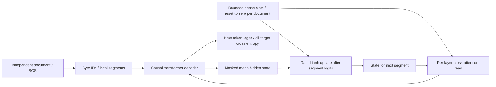

# Current implementation

The additive [owned next-token LM v1](research/owned-lm-v1-design.md) reuses the
existing recurrent decoder for complete-document next-token training and explicit
state reset. Its checkpoint type is `toruk-owned-next-token-v1`; experimental CLI
entry point is `python -m toruk_lm.owned_lm`. This path is separate from ordinary
foundation and pretrained chat checkpoints. Its [bounded synthetic evaluation](research/owned-lm-v1-results.md)
failed the declared quality criterion. The sections below retain the ordinary and
historical research contracts; statements about the ordinary decoder's absence of
state do not apply to the experimental owned recurrent model.

Gradients flow through updates across at most 384 document targets. Primary model:
259 byte/special tokens, width 32, two layers, four heads, 32 local positions,
four 32-float slots (512 state tensor bytes), 56,064 parameters. Nothing except
parameters/optimizer/RNG/data progress crosses unrelated document boundaries.
`owned_lm.py` exposes actual read/update ablations; `owned_training.py` implements
document-boundary AdamW training, strict format/runtime validation, atomic save,
resume, evaluation and generation; `owned_data.py` supplies versioned IID synthetic
documents. The unchanged `recurrent.py` core is reused, not a new memory algorithm.
No pretrained backbone, selector or symbolic evidence parser participates here.

`conversation_data.py` is an offline data-readiness prerequisite, not a trained
chat adapter. Its versioned JSON role-line format escapes newlines inside content,
uses explicit alternating turns and an `assistant:` generation prefix. Each
conversation is one independent document; a future trainer must reset state at
its boundary. It validates cross-split conversations and complete held-out answer
text in new and inherited training documents, emitting a filtered pretraining
corpus without altering the inherited checkpoint's identity. The
[readiness report](research/conversation-readiness-v1-results.md) records the
strict gate failure, literal-overlap caveat and unrun conversational pilot.
This is separate from existing next-token checkpoints and the API/UI, which still
use the identified pretrained chat backbone. No experimental owned-LM chat option
has been added. Fine-tuning initialization across datasets is future work: the
existing resume operation correctly rejects changed dataset/config identities.

Toruk-LM is the model family; `toruk_lm` is the package. The ordinary decoder uses
learned byte/position embeddings, pre-norm causal self-attention and a GELU MLP
per layer, final normalization, and an untied output projection. Dropout is zero.
The ordinary variant has no memory. The additional controlled/recurrent research
pipeline is documented in [M3 implementation](research/m3-implementation.md) and
[M4–M6 protocol](research/m6-validation-protocol.md). Protected revisions do not exist.

ByteTokenizer has PAD=0, BOS=1, EOS=2, UTF-8 byte b mapped to b+3. Its immutable
identity/fingerprint is recorded in checkpoints. Padding is right-only; fully
padded examples are rejected. Attention excludes padded keys and future tokens;
cross entropy ignores targets -100. Loss normalization counts valid targets.

Each document is encoded independently, then partitioned into input windows of
at most C tokens, excluding final EOS. Targets are shifted once by the loader.
The previous window's final logit scores the next window's first input token.
That token is not scored again. Windows restart positional embeddings at zero.
Training windows shuffle with seed+epoch, deterministically; the ordinary model
has no state between windows. Validation uses ordered document windows and the
same context limit. This reports nonoverlapping-window byte/EOS loss, not the
loss of a full rolling context at every position.

Greedy generation recomputes the last at most C tokens on every step with
positions restarted at zero. BOS/PAD are suppressed in sampling; EOS stops.
There is no cache or streaming memory session. Calls do not mutate document
state. Evaluation separates teacher-forced text loss from generated text
continuations. Continuations are not factual QA and have no accuracy claim.

Training is float32 CPU AdamW, fixed LR, deterministic algorithms, one CPU thread
by default. Finite loss and gradients are mandatory. Checkpoints save completed
optimizer boundaries atomically with model, optimizer, scheduler=None, Python and
CPU Torch RNG states, configurations, tokenizer hash, train/validation hashes,
and next-step/example cursor. No CUDA training is supported in this stage.
Resume reconstructs the same deterministic window ordering and rejects changed
configuration/data/tokenizer/format. Exact continuation is tested on this CPU
runtime; cross-version/platform bitwise reproducibility is not promised.
No mid-update or recurrent mid-document resume contract is supported.

Data generation writes all three splits and their fingerprints without fitting
the tokenizer. The pilot consumes train/validation only; the final test split is
never loaded for scoring. The generator is a small prose fixture, not M2's
controlled-world generator/oracle. Train rejects overlapping IDs and identical
train/validation text. Generated fixture IDs across all splits are tested disjoint.

The proposed future memory design is in [research/m3-memory-contract.md](research/m3-memory-contract.md).

The preceding sections document the preserved ordinary foundation. The proposed
contract is historical; the implemented one-lane bounded-document trainer and
its explicit deviations are in the M3 implementation note. Controlled-world
generation/scoring is in `worlds.py`; recurrent state/session code in
`recurrent.py`; ordered training and answer evaluation in `controlled.py`;
runtime prediction in `effect_predictor.py`; future-only supervision in
`effect_training.py`; bounded experiments/integrity aggregation in `comparisons.py`.
Runtime prediction does not import world/oracle/offline label code. The new
controlled checkpoint format is separate from ordinary checkpoints.

`generalization.py` verifies the sealed M6 kernels and reproduces saved generated
answers before allowing frozen-checkpoint M7 studies. Held-out manifests bind
data, transformations, model/predictor hashes and protocols; evaluation-only
datasets are rejected by training loaders. This describes the historical study's
integrity requirements, not a guarantee that today's kernels match its archive.
Current exact historical replay is blocked by archived-source identity mismatch
and missing original weights; see [reproduction limits](reproducibility.md).
Saved-output rescoring is distinct from new model inference. Oracle/stratum
analysis remains offline. See [M7 protocol](research/m7-protocol.md) for study
scope and limits.

## Current chat history selection

The [independent replication package](research/independent-replication-v1-results.md)
evaluates this frozen mechanism without changing it. `independent_replication.py`
counts actual history/fitting tokenization, selection, generation and request
CPU time; records original/selected sources and generated token IDs; and audits
saved prompts against the tokenizer. A separate authored-card assembly procedure
uses heterogeneous distractors. Ablations remove only the envelope, learned
ranking, or cutoff relaxation. There is no persistent memory writer or semantic
compressor in this path. Its independent efficiency/quality gate fails despite
a higher narrow-rubric score; the draft documents this tradeoff.

The research-only `rank_budget.py` follow-up wraps the frozen learned ranker
with `RankBudgetSelector`: keep its two highest-scoring earlier user turns
without the absolute 0.2 cutoff, plus the same three recent turns. It retains
chronological order and the existing source envelope, input/storage limits and
512-token final prompt fit. It adds no persistent state, fact parser, generation
rule or model weights. Low-scoring irrelevant turns can now enter the prompt;
ranking mistakes, two-source capacity and decoder errors remain possible.
`scripts/rank_budget_study.py` seals the fixed V2 cases and runtime, freezes
development outputs, and requires that freeze before heldout inference. The
browser/server defaults are unchanged. See the
[protocol](research/rank-budget-v1-protocol.md) and
[measured result](research/rank-budget-v1-results.md).

The separate [exact/gist/reference experiment](research/recall-v2-protocol.md)
adds a research-only source transcript envelope around the existing selected
turns. It preserves source text and provenance, then uses the same 512-token
prompt fit and pretrained decoder. It does not create a compressed gist store,
guarantee exact copying, or enforce clarification. The ordinary browser/server
path does not use this intervention. Its implementation and measured failures
are recorded separately from existing frozen selectors and integrated models.

The local conversational page can run either the historical M6 controlled-world
checkpoint as an experimental turn selector or the separate
`toruk-chat-selector-v1` JSON checkpoint. V1 is an eight-feature logistic
ranker trained on labeled synthetic conversation evidence. It scans all
supplied turns and retains at most two older user turns plus the latest three
messages before the backbone's 512-token fit. It does not update model
weights, store persistent memory, or prove semantic relevance. The frozen
[protocol](research/chat-selector-v1-protocol.md) and
[results](research/chat-selector-v1-results.md) distinguish its narrow
synthetic gain from a failed vault-code paraphrase. Status and responses
identify the selected checkpoint by format and SHA-256.

## Future: a genuinely Toruk-trained conversational LM

The current chat page uses an external pretrained instruct model for language
ability. Its frozen Toruk checkpoint only ranks earlier turns. A conversational
Toruk model would require training the decoder and a bounded state updater
together, including learned write, revise, retain, and read decisions. The
state must have a fixed byte/token budget independent of conversation length;
the answer head must learn to use that state and abstain when evidence is absent.

Build training data with licensed ordinary dialogue plus long conversations
containing delayed facts, explicit corrections, unrelated facts to preserve,
irrelevant turns, contradictions, and genuinely unknown answers. Separate
people, templates, topics, and long-range compositions between train and held-out
splits. Optimize next-token prediction and answer likelihood alongside supervised
state-update, correction, preservation, and abstention objectives. Measure the
cost of reading all turns and updating state, not just the final prompt size.

This is a new training program, beyond a 4 GiB GPU local fine-tune of a 3B
decoder. First run small controlled ablations and estimate accelerator memory,
GPU-hours, data volume, and energy from pilot throughput; full pretraining or
joint 3B training needs a separately budgeted multi-GPU resource plan. Compare
against the same pretrained decoder with full/recent context, retrieval, a
summary cache, and a matched-capacity recurrent model. Hold the backbone,
tokenizer, data, decoding, and total compute budget fixed when isolating the
memory mechanism. Require independent seeds, unseen long-range tasks, reliable
correction and unknown-answer scores, and end-to-end latency/memory measurements
with confidence intervals before attributing any gain to Toruk training.
