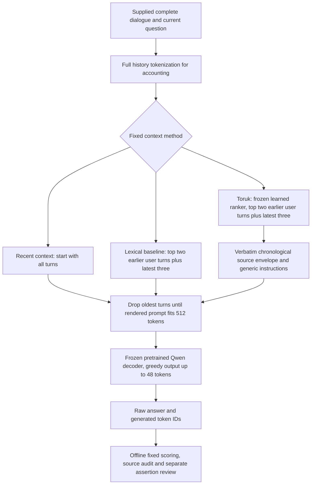

# Bounded turn selection under a small conversational context budget

**Exploratory research draft. Not submitted, peer reviewed or a claim of a
verified Toruk advantage.** Numerical results and uncertainty are in the
measured-results section below. All empirical statements
must be read with the [claim ledger](claim-ledger.md).

## Abstract and problem statement

Long conversational histories can exceed a decoder's prompt budget. Selecting
older turns may preserve distant evidence while reducing model-prefill work,
but selection itself scans history and can remove corrections or introduce
competing obsolete values. We test the falsifiable claim that Toruk's existing
turn selector preserves or improves factual answers at lower measured request
cost than recent context and simple lexical retrieval. This study first
reproduces the previous experiment, then evaluates frozen code on separately
authored operational scenarios and performs actual-component ablations. It is
an exploratory local study rather than a qualification of general memory.
The prior experiment reproduces exactly. On 24 separately authored scenarios,
Toruk scores 9/24 versus lexical retrieval's 6/24, but consumes 33.1% more model
tokens and 19.7% more request time. Its paired quality interval includes zero;
the registered efficiency/quality gate fails. Removing the envelope preserves
the observed 9/24 total while reducing cost. These results expose a quality/cost
tradeoff rather than establishing the central efficiency claim. [C16–C19]

## Implemented system

The conversational backbone is **Qwen/Qwen2.5-0.5B-Instruct**, supplied by its
pretraining provider and unchanged here. Toruk's own trainable component in
this path is an eight-feature logistic turn scorer fitted previously on synthetic
evidence labels (seed 173, 180 Adam steps). Its weights are frozen. There is no
new decoder training, learned memory writer or recurrent latent state in the
evaluated conversational path. The repository's separate ordinary/recurrent
language-model prototypes are not evaluated as this chatbot. [C01–C03]

The source envelope bundles chronological labels and generic directions about
copying, correction and clarification. Its ablation removes that bundle as a
whole; this study cannot attribute effects to formatting versus instruction
wording. Sources are not semantically compressed or rewritten. Each request
rescans its supplied history. No state persists between requests. Prompt fitting
can evict selected evidence, and the decoder can still alter available facts.
Bounds are 64 messages/16 KiB input, at most eight selected sources/4 KiB source
content, 512 prompt tokens and 48 generated tokens. These exclude model weights
and framework/tokenizer/Python overhead. [C02–C04]

## Hypothesis, baselines and ablations

The [frozen protocol](../independent-replication-v1-protocol.md) requires at least
lexical-baseline correctness, no greater unsupported proxy, lower full-request
latency and fewer model prompt-plus-output tokens on the independent set. Any
confirmatory superiority language additionally requires a strictly positive
paired 95% interval for quality gain or latency saving. These conditions test
specified warm-request cost metrics, not total lifecycle energy or FLOPs.

Comparisons share backbone/tokenizer bytes, instructions, CPU float32, two Torch
threads, greedy temperature 0/top-p 1 and prompt/output caps. Recent context and
unchanged lexical-v1 retrieval are actual baselines. Three one-choice ablations
remove the envelope, remove learned scoring through constant-score ranking, or
remove cutoff relaxation by restoring the original 0.2 threshold. Candidate
capacity, recency retention and chronological source ordering otherwise stay
fixed. No persistent memory, fact editor or compressor is invented for a table.
The choice of lexical retrieval leaves stronger retrieval/compression systems
untested. [C05–C06]

## Datasets and leakage controls

The controlled dataset is the already published recall V2 heldout set: 12
synthetic project-code/date/gist/reference worlds, each with 18 repeated weather
distraction pairs. Its development and heldout question/record wording families
were separated; historical V1's weaker separation is not presented as strict
heldout evidence. Because the V2 results informed prior development and are
public, their reuse here is a replication and diagnostic, not a new unseen test.
[C07–C08]

The second dataset uses a different construction procedure: 24 manually authored
scenario cards, assembled with heterogeneous seeded distractors and varying
early event positions. Categories are distant facts, corrections, preservation,
exact strings, vague references and insufficient evidence, four each. The cards
include two assistant-origin facts, an existing limitation for selectors that
consider only older user turns. The assembly seed is 20261104; histories contain
47–57 messages and 19–25 trailing distraction pairs. Questions and fact text
were compared against the selector's training/development/final data and both
recall versions: no exact normalized task-text overlap was found. [C09–C10]

The mechanism freeze precedes card construction; the complete dataset, scoring,
code and method order are sealed before independent inference. No training uses
these cases. The authors nevertheless knew prior failure modes. This is a new
synthetic dataset procedure, not independent investigators, human-derived
dialogue, an external benchmark, or a semantic/pretraining contamination proof.
The independent set has no gist questions, so category mixes differ and scores
must not be pooled across the two datasets. [C09–C11]

## Measurement and analysis

The previous `recall_study.score` bytes remain fixed on both datasets. Exact
answers require whole-string equality after outer whitespace removal. Other
tasks use its existing lexical concept, forbidden-value and uncertainty checks.
The unsupported field is a proxy; it misses some false assertions and marks
some honest refusals as failures. A separate exhaustive assistant assertion
review records each output and rationale and is never substituted for the
primary scores. It is not independent human validation. [C12–C13]

Every request stores selected sources before/after fitting, source hashes,
actual prompt and generated token IDs, answer, scores, evidence flags, all
tokenization/fitting positions, logical scan/source bytes, selection/fitting/
generation timings, full request latency, process CPU time, RSS and process high
water. A tokenizer-only audit reconstructs prompts and work and independently
recomputes the frozen rubric. This audit does not independently validate semantic
answers. Method order rotates by question and is balanced over both datasets.
Raw per-question data expose regressions as well as gains. [C14]

Wilson intervals describe each accuracy estimate. Paired scenario bootstrap
intervals use 10,000 resamples and seed 741. They reflect this authored case set,
not the uncertainty of a random conversational population. One historical
training seed, one backbone, one CPU host and one independent assembly seed are
used. There is no multiple-seed training or hardware-replication claim. [C15]

## Main results, ablations and failures

The evidence gate reproduces **96/96** previous development/heldout rows exactly,
including actual prompts, answers, scoring, evidence and deterministic token
counts. The previous cutoff intervention's criterion remains failed: correctness
increased but its unsupported proxy exceeded the registered bound. That result
is not presented as successful qualification. [C16]

| Dataset / method | Primary correct | Unsupported proxy | Prompt / output tokens | Request seconds |
|---|---:|---:|---:|---:|
| Controlled / recent | 0/12 | 2 | 5,886 /167 | 59.07 |
| Controlled / lexical | 4/12 | 2 | 2,152 /207 | 40.21 |
| Controlled / Toruk | 8/12 | 3 | 2,931 /193 | 43.84 |
| Independent / recent | 3/24 | 3 | 12,136 /450 | 134.92 |
| Independent / lexical | 6/24 | 9 | 4,293 /204 | 52.92 |
| Independent / Toruk | 9/24 | 8 | 5,783 /204 | 63.33 |

Independent paired 95% quality difference versus lexical is −4.2 to +29.2
percentage points. Its latency-saving interval is −37.2% to −1.6%, favoring
lexical. Toruk's independent Wilson accuracy interval is 21.2–57.3%; lexical's
is 12.0–44.9%. The frozen efficiency/quality gate fails on both datasets.
These are descriptive intervals for the authored scenarios, not population
or training-seed guarantees. [C15, C17–C18]

| Ablation | Controlled correct /12 | Independent correct /24 | Independent request seconds |
|---|---:|---:|---:|
| Full system | 8 | 9 | 63.33 |
| No envelope | 7 | 9 | 56.48 |
| No learned ranking | 0 | 1 | 120.81 |
| Restore original cutoff | 4 | 8 | 71.62 |

The independent envelope has two gains and two regressions; its equal total
does not establish equivalence. Learned ranking helps against a constant-score
ablation but this does not prove superiority to lexical selection. [C19]

Actual failures include `R-6` after a recorded correction to `T-2`, and
`2045-08-16` after a move to `2045-08-23`, both with source events retained.
The engraving `Hold!  then listen.` becomes `"Hold! Then listen."`. Both
assistant-origin fact cases fail for every method. Honest “serial number was
not logged” output also fails the frozen uncertainty matcher. Thus generated
factual errors, source eligibility, exact copying and scoring error must be
distinguished. The separate subjective assertion review flags 5/24 Toruk versus
11/24 lexical answer bindings on the independent set, and 2/12 versus 7/12 on controlled;
it is not independent semantic ground truth. [C13, C20]

See [measured results](../independent-replication-v1-results.md) and the generated
[full table](../../../artifacts/independent-replication-20261104/evaluation/table.md)
for final, separate controlled and independent scores, actual ablations,
uncertainty and failure examples. [C17–C20]

## Cost accounting and limits

The cost vector is history tokenization, repeated-fit tokenization, model
prefill/output tokens, logical selector scan bytes, measured selector/fitting/
model time, total warm-request latency and CPU time, selected source bytes, and
RSS/high water. Model initialization and complete subprocess/stage wall time are
reported separately. JSON logging and offline audits add work outside request
latency but inside stage/check logs. Each method shares the loaded backbone;
per-method times do not include a separately loaded model. [C14, C21]

Tokenizer positions are not FLOPs. Generated-token cost is not interchangeable
with prefill cost. Process high water is cumulative, not per-selector allocation.
New research training is zero, but historical selector and Qwen pretraining cost
are not fully accounted for. Energy, electricity price and exact FLOPs are
unmeasured. A short selected prompt alone cannot establish lower total resource
cost, and a warm-request result cannot establish a lifecycle saving. [C21–C22]

## Research positioning

The [primary-source comparison matrix](positioning.md) covers recurrent memory,
retrieval, token and gist compression, long-context QA, and current 2026 agent
memory work, with publication/version dates and cost scopes. Toruk's actual
distinction is cheap supervised turn ranking plus bounded raw-source
presentation; it is not a new recurrent architecture or semantic compressor.
Published systems were not rerun as matched baselines. No first-of-kind or IEEE
Xplore absence claim is supported. [C23–C24]

## Threats to validity and submission status

The small synthetic sets, author knowledge of earlier failures, different task
mixes, shared scaffold correlations, narrow lexical rubric, subjective assertion
review, unavailable pretraining provenance and single host/backbone/training
seed constrain interpretation. Balanced order reduces fixed ordering bias but
does not control host load or establish stable latency differences. A 512-token
cap deliberately tests selection under scarcity; it does not compare against
the backbone's full supported long context. No full-context, strong dense
retrieval, learned compression, real multi-session benchmark or independent
human-adjudicated result is claimed. [C11–C15, C22, C24]

This package is suitable for inspection and further replication as an exploratory
study. A submission claiming a broadly useful efficiency/quality advantage
requires independent evaluation and adjudication beyond these authored cases.
The next submission decision must follow the measured results and claim ledger,
including negative outcomes. [C25]
